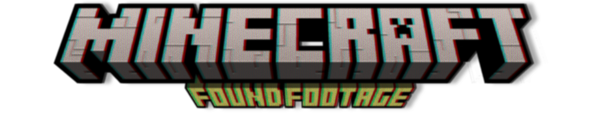

# Backrooms FF Continued

A continuation of **SP-Backrooms Revamped** (Spacepotato's "Minecraft Found Footage" mod), updated for **Minecraft 26.2** (Fabric) and made to run on **macOS**.

## About

This is a maintenance/continuation fork by **ARBird**. The original 1.20.1 mod relied on the Veil
GLSL deferred-rendering shader library, which does not run on macOS. This version is being ported to
26.2 with the Veil visual layer rebuilt using Mac-safe techniques (HUD overlays + vanilla rendering).

Original mod by **SpacePotato** and **Herr Chaos** — see <https://github.com/SpacePotatoee/SPBackrooms-Revamped>.
Licensed under **LGPL-3.0-only** (see `LICENSE`).

## Status

Port to Minecraft 26.2 is in progress. See `docs/superpowers/specs/` for the migration design.
